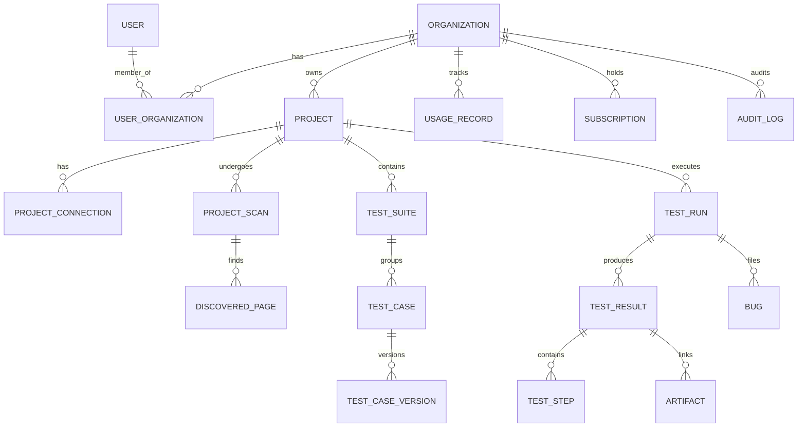

# AI QA Agent — Data Model Specification

## 1. Relational Entity Overview
All entities are scoped to an `organization_id` (except system users and global lookup constants).

## 2. Table Specifications

### 2.1. `users`
- `id`: UUID (Primary Key)
- `email`: VARCHAR(255) (Unique, Indexed)
- `hashed_password`: VARCHAR(255) (Argon2id/Bcrypt)
- `full_name`: VARCHAR(255)
- `is_active`: BOOLEAN (Default: true)
- `is_superuser`: BOOLEAN (Default: false)
- `created_at`: TIMESTAMP WITH TIME ZONE
- `updated_at`: TIMESTAMP WITH TIME ZONE

### 2.2. `organizations`
- `id`: UUID (Primary Key)
- `name`: VARCHAR(255)
- `slug`: VARCHAR(255) (Unique, Indexed)
- `plan_tier`: VARCHAR(50) (e.g., 'free', 'pro', 'team')
- `created_at`: TIMESTAMP WITH TIME ZONE
- `updated_at`: TIMESTAMP WITH TIME ZONE

### 2.3. `organization_members`
- `id`: UUID (Primary Key)
- `organization_id`: UUID (FK -> organizations.id, ondelete CASCADE)
- `user_id`: UUID (FK -> users.id, ondelete CASCADE)
- `role`: VARCHAR(50) (enum: 'owner', 'admin', 'member', 'viewer')
- `created_at`: TIMESTAMP WITH TIME ZONE
- Unique constraint: `(organization_id, user_id)`

### 2.4. `projects`
- `id`: UUID (Primary Key)
- `organization_id`: UUID (FK -> organizations.id, ondelete CASCADE, Indexed)
- `name`: VARCHAR(255)
- `description`: TEXT
- `target_url`: VARCHAR(2048) (Verified target URL)
- `github_repo`: VARCHAR(255) (Nullable)
- `environment`: VARCHAR(50) (enum: 'staging', 'preview', 'production', 'dev')
- `status`: VARCHAR(50) (enum: 'active', 'archived')
- `created_at`: TIMESTAMP WITH TIME ZONE
- `updated_at`: TIMESTAMP WITH TIME ZONE

### 2.5. `project_connections`
- `id`: UUID (Primary Key)
- `project_id`: UUID (FK -> projects.id, ondelete CASCADE)
- `connection_type`: VARCHAR(50) (e.g. 'github', 'url_auth', 'api_docs')
- `credentials_encrypted`: TEXT (Fernet / AES-GCM encrypted tokens)
- `status`: VARCHAR(50) (enum: 'connected', 'invalid', 'disconnected')
- `last_verified_at`: TIMESTAMP WITH TIME ZONE

### 2.6. `project_scans`
- `id`: UUID (Primary Key)
- `project_id`: UUID (FK -> projects.id, ondelete CASCADE, Indexed)
- `scan_type`: VARCHAR(50) (enum: 'url_crawler', 'github_code', 'hybrid')
- `status`: VARCHAR(50) (enum: 'pending', 'running', 'completed', 'failed')
- `started_at`: TIMESTAMP WITH TIME ZONE
- `completed_at`: TIMESTAMP WITH TIME ZONE
- `summary`: JSONB (metrics, page count, form count)
- `error_message`: TEXT

### 2.7. `discovered_pages`
- `id`: UUID (Primary Key)
- `scan_id`: UUID (FK -> project_scans.id, ondelete CASCADE, Indexed)
- `project_id`: UUID (FK -> projects.id, ondelete CASCADE)
- `url`: VARCHAR(2048)
- `path`: VARCHAR(1024)
- `http_status`: INT
- `title`: VARCHAR(512)
- `forms_detected`: JSONB (Inputs, roles, buttons, labels)
- `accessibility_tree`: JSONB (Key accessibility nodes)
- `provenance`: VARCHAR(50) (enum: 'observed', 'source_code', 'ai_inferred', 'unverified')
- `created_at`: TIMESTAMP WITH TIME ZONE

### 2.8. `test_suites`
- `id`: UUID (Primary Key)
- `project_id`: UUID (FK -> projects.id, ondelete CASCADE, Indexed)
- `name`: VARCHAR(255)
- `description`: TEXT
- `category`: VARCHAR(50) (e.g., 'smoke', 'regression', 'critical_path')
- `created_at`: TIMESTAMP WITH TIME ZONE

### 2.9. `test_cases` & `test_case_versions`
- `id`: UUID (Primary Key)
- `project_id`: UUID (FK -> projects.id, ondelete CASCADE, Indexed)
- `suite_id`: UUID (FK -> test_suites.id, ondelete SET NULL, Nullable)
- `code_identifier`: VARCHAR(50) (e.g. 'TC-001', Unique per project)
- `title`: VARCHAR(255)
- `category`: VARCHAR(50) (enum: 'Functional', 'Negative', 'Boundary Value', 'Validation', 'Regression', 'Smoke', 'API', 'Accessibility', 'Visual', 'Exploratory')
- `priority`: VARCHAR(20) (enum: 'low', 'medium', 'high', 'critical')
- `risk_level`: VARCHAR(20) (enum: 'low', 'medium', 'high')
- `automation_status`: VARCHAR(50) (enum: 'manual_only', 'automated', 'candidate', 'in_progress')
- `approval_status`: VARCHAR(50) (enum: 'draft', 'in_review', 'approved', 'archived')
- `current_version`: INT (Default: 1)
- `ai_confidence_score`: FLOAT (0.0 to 1.0, Nullable)
- `provenance`: VARCHAR(50) (enum: 'observed', 'source_code', 'ai_inferred', 'manual')
- `latest_spec`: JSONB (preconditions, steps, expected_result, test_data)

### 2.10. `test_runs`
- `id`: UUID (Primary Key)
- `project_id`: UUID (FK -> projects.id, ondelete CASCADE, Indexed)
- `organization_id`: UUID (FK -> organizations.id, ondelete CASCADE, Indexed)
- `trigger`: VARCHAR(50) (enum: 'manual', 'schedule', 'webhook', 'ci')
- `status`: VARCHAR(50) (enum: 'queued', 'starting', 'running', 'passed', 'failed', 'blocked', 'cancelled', 'timed_out', 'flaky')
- `total_cases`: INT (Default: 0)
- `passed_cases`: INT (Default: 0)
- `failed_cases`: INT (Default: 0)
- `duration_ms`: INT (Default: 0)
- `started_at`: TIMESTAMP WITH TIME ZONE
- `completed_at`: TIMESTAMP WITH TIME ZONE

### 2.11. `test_results` & `test_steps`
- Stores granular pass/fail status per test case and per step within a run.
- `step_number`: INT
- `action_type`: VARCHAR(50) (e.g., 'goto', 'click', 'fill', 'assert_visible')
- `target_locator`: VARCHAR(512)
- `status`: VARCHAR(50) ('passed', 'failed', 'skipped')
- `actual_result`: TEXT
- `error_message`: TEXT
- `duration_ms`: INT

### 2.12. `artifacts`
- `id`: UUID (Primary Key)
- `test_result_id`: UUID (FK -> test_results.id, ondelete CASCADE)
- `artifact_type`: VARCHAR(50) (enum: 'screenshot', 'playwright_trace', 'console_log', 'network_har')
- `storage_path`: VARCHAR(1024) (S3 bucket key)
- `mime_type`: VARCHAR(100)
- `file_size_bytes`: BIGINT

### 2.13. `bugs`
- `id`: UUID (Primary Key)
- `project_id`: UUID (FK -> projects.id, ondelete CASCADE)
- `test_result_id`: UUID (FK -> test_results.id, ondelete SET NULL)
- `title`: VARCHAR(255)
- `description`: TEXT
- `severity`: VARCHAR(20) (enum: 'low', 'medium', 'high', 'critical')
- `reproduction_steps`: JSONB
- `expected_behavior`: TEXT
- `actual_behavior`: TEXT
- `root_cause_hypothesis`: TEXT
- `verified_cause`: TEXT
- `status`: VARCHAR(50) (enum: 'open', 'in_investigation', 'resolved', 'ignored')

### 2.14. `usage_records` & `subscriptions`
- Tracks test execution minutes, AI token costs, concurrent runs, and storage byte usage per organization against plan tier quota.

### 2.15. `audit_logs`
- Immutably records security events (user login, role elevation, project deletion, test run cancellations).
